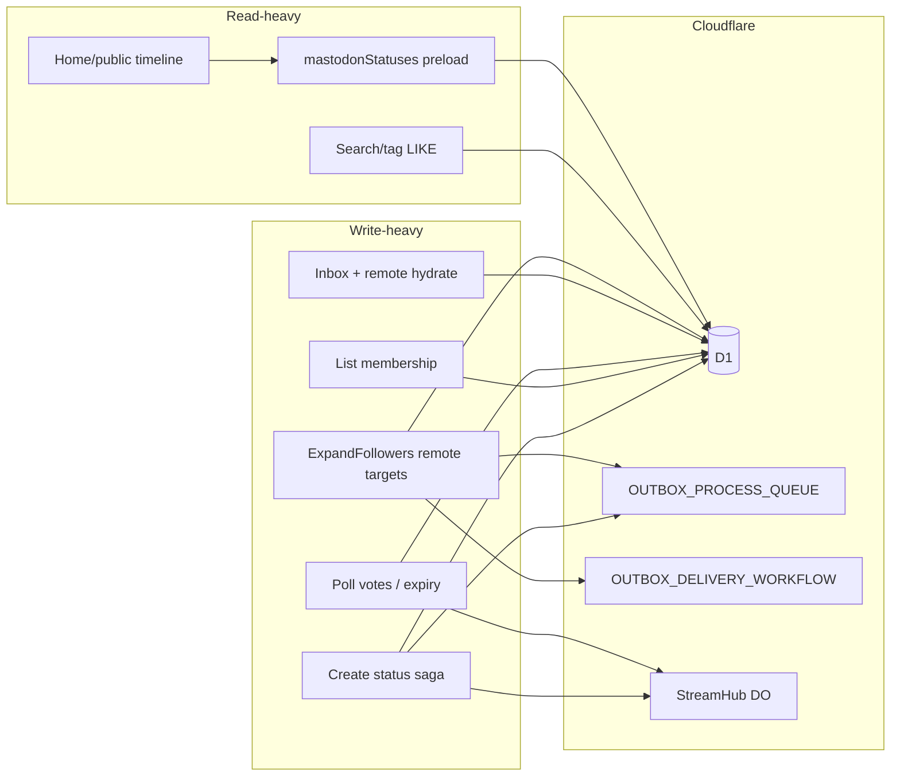

# Heavy D1 Scenarios: Assumptions and Mitigations

| Field          | Value                                                |
| -------------- | ---------------------------------------------------- |
| Author         | tstodon maintainers                                  |
| Date           | 2026-09-23                                           |
| Status         | Draft                                                |
| Audience       | Senior engineers capacity-planning Worker + D1 paths |
| Published path | `docs/architecture/d1-heavy-scenarios.md`            |

## Overview

<!-- constrained-by ./d1-write-strategy.md -->
<!-- constrained-by ./tstodon-architecture.md#cloudflare-mapping -->
<!-- constrained-by ./d1-writes.md -->

This document catalogs **realistic heavy D1 paths** for a Mastodon-compatible Cloudflare Workers server, what the codebase already does to blunt them, and what to do next. It is deliberately scoped to **local / small-instance** operation — not Twitter-scale. Write mechanics (batching, UPSERT, TypedSQL, json_each) are defined in the companion [D1 Write Strategy](./d1-write-strategy.md); this document applies those rules under load.

Every numeric load figure below is labeled **Assumption** unless it cites an in-code constant or helper.

## Background & Motivation

<!-- derived-from ./d1-write-strategy.md#platform-constraints-write-relevant -->

D1 gives tstodon a familiar relational model, but several Mastodon shapes amplify query and write fan-out:

- Timeline pages need N statuses × accounts × counts × media × polls × reblog chains.
- Outbox delivery expands one activity into many **remote** inbox targets.
- Inbox and remote hydrate paths couple HTTP fetch with idempotent inserts.
- Status text search reads an FTS5 index ([status search](./status-search.md)); local tag matching reads the `local_status_tags` index.
- Cron poll expiry walks a batch of rows and publishes stream events.
- Status Create is a multi-helper saga with partial-failure modes ([Doc A](./d1-write-strategy.md#status-publish-composition-route-level-gap)).

Without explicit assumptions, agents and reviewers over-fit for hyperscale or under-invest in the paths that already hurt small instances (bind limits, writer serialization, N+1 document assembly).

## Goals & Non-Goals

### Goals

- Name the heavy paths with concrete code anchors (`mastodonStatuses`, `ExpandFollowers`, etc.).
- Separate **in-code mitigations** from **proposed next steps**.
- Tie every write-heavy recommendation back to Doc A helpers.
- State load assumptions so capacity talk stays honest.

### Non-Goals

- Guaranteeing multi-region active-active D1.
- Replacing D1 with a different primary store.
- Implementing Vectorize / Workers AI search in this design (architecture notes them as future).
- Full Mastodon parity performance vs. PostgreSQL + Redis Sidekiq deployments.

## Load assumptions (explicit)

| ID  | Assumption / fact                                                                                                                              | Notes                                                                                                               |
| --- | ---------------------------------------------------------------------------------------------------------------------------------------------- | ------------------------------------------------------------------------------------------------------------------- |
| A1  | **Assumption:** local / small-instance first                                                                                                   | Tens to low hundreds of local accounts; not a global Twitter-class timeline                                         |
| A2  | **Fact:** `queryLimit` defaults to **20** and **clamps to max 40** (`packages/worker/server/http.ts`). **Assumption:** clients usually ask ≤40 | Callers cannot request >40 through this helper                                                                      |
| A3  | **Fact:** reblog/reply depth for document assembly                                                                                             | Code bounds chain resolution to **4 passes** in `mastodonStatuses`                                                  |
| A4  | **Fact:** status context caps                                                                                                                  | `CONTEXT_ANCESTOR_LIMIT = 40`, `CONTEXT_DESCENDANT_LIMIT = 60` in `status-store.ts`                                 |
| A5  | **Assumption:** remote followers per local actor                                                                                               | ≤ a few hundred accepted remote followers for early deployments                                                     |
| A6  | **Fact:** list membership edits may exceed 100                                                                                                 | Code already chunk-batches at 100                                                                                   |
| A7  | **Fact:** poll expiry cron batch size                                                                                                          | Up to **50** expired unnotified polls per `ProcessExpiredPolls` job                                                 |
| A8  | **Fact:** search default limit                                                                                                                 | `queryLimit(..., 5)` on search routes; hashtag/status `LIKE` still full-scan within LIMIT                           |
| A9  | **Fact:** D1 platform                                                                                                                          | 100 bind params; batch soft chunk 100; single-primary write serialization; query duration / Worker CPU limits apply |
| A10 | **Assumption:** not Twitter-scale                                                                                                              | No claim that home timelines of 10k+ followees or celebrity fan-out are in scope without further design             |

If a production target violates A1/A5/A10, revisit fan-out and read models before tuning SQL micro-optimizations.

## Platform limits (reminder)

<!-- constrained-by ./d1-write-strategy.md#platform-constraints-write-relevant -->
<!-- constrained-by ./adr-json-each-membership.md -->

| Limit                          | Code / platform             | Failure mode                                                               |
| ------------------------------ | --------------------------- | -------------------------------------------------------------------------- |
| 100 bound parameters           | `D1_MAX_BOUND_PARAMETERS`   | Statement rejected → Worker 500 (cfwdon)                                   |
| Batch statement soft cap       | `D1_BATCH_CHUNK_SIZE = 100` | Oversized batches should be chunked                                        |
| Single-primary writer          | Cloudflare D1               | Concurrent writers queue; `Promise.all` writes do not parallelize usefully |
| Query duration / Worker limits | Platform                    | Long `LIKE` scans or huge batches risk timeouts                            |
| No interactive transactions    | Platform                    | Use Doc A UPSERT / batch patterns                                          |

## Heavy path catalog



### 1. Home / public timeline pages → `mastodonStatuses`

<!-- constrained-by ./d1-writes.md#timeline--status-document-reads -->

**Shape:** list statuses (`listHomeStatuses` / `listPublicStatuses` / account timelines) then assemble Mastodon JSON for the page. Home timeline SQL already joins accepted `follows` (`status-timeline-store.ts`); local followers do **not** need ActivityPub inbox POST for Create visibility.

**Amplifiers:**

- Each `LocalNote` needs account doc, interaction counts, media, optional poll, reply parent account id.
- `LocalReblog` needs the reblog target (and nested reblog) document.
- Naive per-item `mastodonStatus` would be O(N) query storms.

**In code today** (`packages/worker/server/local-status-documents.ts`):

1. Seed map with page statuses.
2. Up to **4 passes** of `findStatusesByIds` for missing reblog targets / reply parents (`sqlInJsonEach`).
3. Collect account ids, note ids, media ids.
4. `Promise.all` of **reads**: `findAccountsByIds`, `accountCountsByIds`, `statusInteractionCountsByIds`, `findPollsByStatusIds`, `findMediaByIds`.
5. Build documents in memory; `mastodonStatus` delegates to `mastodonStatuses([status])`.

`accountCountsByIds` and `statusInteractionCountsByIds` read the trigger-kept `account_stats` and `status_stats` rows by `json_each`; the latter batches them with the viewer's flags (Doc A read-side batch pattern).

**Risks:**

| Severity | Risk                                                           | Mitigation now       | Next                                                                                                                  |
| -------- | -------------------------------------------------------------- | -------------------- | --------------------------------------------------------------------------------------------------------------------- |
| Med      | Many round-trips still (chain passes + 5 parallel read groups) | Preload + json_each  | **Defer** collapsing five `Promise.all` reads into one `runD1Batch` until metrics exist (see Open Questions #2 / PR5) |
| Med      | Deep reblog chains truncated after 4 passes                    | Hard cap             | Document API behavior; optional 5th pass only if measured                                                             |
| Low      | Partial degrade if one preload fails                           | Maps fall back empty | Surface metrics on preload `RepositoryError`                                                                          |

**A2/A3:** for ≤40 statuses (hard clamp) and shallow reblogs, current preload is the intended design.

### 2. Fan-out: `ExpandFollowers` + many delivery targets

<!-- constrained-by ./tstodon-architecture.md#implemented-surface -->
<!-- constrained-by ./d1-write-strategy.md#3-outbox-activity--fan-out-row -->

**Shape:**

1. `enqueueLocalActivity` inserts activity + fan-out row (**batched**, Doc A) then queues `ExpandFollowers`. Insert/parse failures are **swallowed** today (Doc A operability gap).
2. `processOutboxJob` (`outbox-job.ts`) **today** still loads local follower ids and builds same-host inbox URLs, then filters them away with `new URL(inbox).host !== sameHost`. **Decided:** **DELETE** that local-follower loop (PR3). Keep only:
   - **Remote** follower inboxes via `listAcceptedRemoteFollowerInboxes` (already coalesces `shared_inbox_uri ?? inbox_uri` into a `Set` — **in code**).
   - Local Create visibility for followers via **home-timeline SQL over `follows`**, not AP inbox POST.
   - `markOutboundExpanded`, then **per remote inbox**: `ensureOutboxTarget` + `startOutboxDeliveryWorkflow` (chunked batching = Doc A PR3).
3. Workflow owns HTTP POST retries (`OUTBOX_DELIVERY_WORKFLOW`).

**In code mitigations:**

- Activity create is a proper Doc A batch.
- Delivery HTTP is off the request path (Queue → Workflow).
- `INSERT OR IGNORE` for targets (`insertOutboxTargetOrIgnore`).
- **Shared-inbox URI coalesce:** `listAcceptedRemoteFollowerInboxes` already dedupes on `shared_inbox_uri ?? inbox_uri`.

**Gaps:**

| Severity | Risk                                                                       | Mitigation now                                                       | Proposed next                                                                                                                                                                |
| -------- | -------------------------------------------------------------------------- | -------------------------------------------------------------------- | ---------------------------------------------------------------------------------------------------------------------------------------------------------------------------- |
| High     | Per-target `ensureOutboxTarget` is sequential `runTyped` + re-read         | Idempotent ignore                                                    | **Chunked `runD1BatchChunked` of target inserts** — implements [Doc A PR3](./d1-write-strategy.md#pr-plan); do not duplicate as a second PR                                  |
| Med      | Local-follower loop does D1 work whose results are same-host-filtered away | Filter works                                                         | **Decided: DELETE** the local-follower inbox construction loop (Doc B PR3); keep remote shared-inbox path only. Do **not** batch `findAccountsByIds` for that discarded path |
| Med      | One queue message expands all remote targets inline                        | Queue isolates publish path                                          | Optional secondary queue / chunked workflow creation if Worker CPU time bites (SLO-driven; see Open Questions)                                                               |
| Low      | Celebrity-scale fan-out                                                    | Shared-inbox coalesce **already in code**; still out of scope at A10 | Caps, secondary queue chunking, followership limits — **not** “add coalescing”                                                                                               |

```mermaid
sequenceDiagram
  participant API
  participant D1
  participant Q as OUTBOX_PROCESS_QUEUE
  participant WF as OUTBOX_DELIVERY_WORKFLOW

  API->>D1: runD1Batch insert activity + fanout row
  API->>Q: ExpandFollowers
  Q->>D1: list remote inboxes shared_inbox coalesce
  Note over Q: local-follower loop deleted; remote shared-inbox path only
  loop per remote inbox today
    Q->>D1: ensureOutboxTarget runTyped
    Q->>WF: create DeliverTarget
  end
  Note over Q,D1: Proposed: batch INSERT OR IGNORE targets in chunks of 100
```

### 3. Inbox bursts / remote status hydrate

**Shape:** ActivityPub inbox accepts signed activities; `insertInboxActivity` uses `INSERT OR IGNORE` on `activity_id`; remote objects hydrate via `persistRemoteObject` (`remote-status-persist.ts`) → fetch (if needed) → `upsertRemoteStatus` (`ON CONFLICT(object_uri)`).

**Amplifiers:**

- Burst of Create/Announce/Follow from many peers.
- Each hydrate may do existence check + HTTP fetch + UPSERT.
- Follow-on writes (notifications, remote favourites/announces) are separate TypedSQL statements with their own conflict keys.

**In code mitigations:**

- Idempotent inserts / `ON CONFLICT` on natural keys — e.g. inbox `activity_id` (`INSERT OR IGNORE`), remote status `object_uri` (UPSERT), remote favourite/announce `(remote_actor_uri, status_id)` (`DO NOTHING` / UPSERT). Do not summarize all of these as “UPSERT on object_uri.”

**Gaps:**

| Severity | Risk                                            | Mitigation now                | Proposed next                                                             |
| -------- | ----------------------------------------------- | ----------------------------- | ------------------------------------------------------------------------- |
| Med      | Read-then-fetch-then-write race duplicates work | Idempotent natural-key writes | Optional short KV negative/positive cache for object URIs                 |
| Med      | Inbox processing on HTTP request thread         | Current handler path          | Consider queue handoff for expensive hydrate (keep signature verify sync) |
| Low      | Unbounded payload size                          | Platform request limits       | Explicit payload size guard in inbox parse                                |

### 4. Poll expiry cron batch

**Shape:** cron → queue `ProcessExpiredPolls` → `listExpiredUnnotifiedPolls(now, 50)` → per poll: load status, `mastodonStatus`, `publishToAccount` (StreamHub DO), `markPollExpiryNotified`.

**In code mitigations:**

- Hard limit **50** per job (A7). A full batch that claimed at least one poll or voter queues the next `ProcessExpiredPolls` job; a run that claims nothing does not.
- Side effects (stream publish) outside the mark write (Doc A rule 4).
- Cron only enqueues; work runs on queue consumer.

**Gaps:**

| Severity | Risk                                                        | Mitigation now           | Proposed next                                                                |
| -------- | ----------------------------------------------------------- | ------------------------ | ---------------------------------------------------------------------------- |
| Med      | Per-poll `mastodonStatus` (preload of 1) + sequential marks | Cap 50                   | Batch-mark notified ids; reuse `mastodonStatuses` for the whole expired page |
| Low      | Backlog if many polls expire same minute                    | Next cron/queue delivery | Loop/enqueue follow-up job while `length === 50`                             |

### 5. Large list membership add/remove

**Shape:** API adds/removes many members → `addListMembers` / `removeListMembers`.

**In code mitigations:**

- `runD1BatchChunked` at 100 (Doc A example).
- `INSERT OR IGNORE` for adds — safe across chunk boundaries.

**Gaps:** low for A6; watch total request CPU if clients send thousands of ids in one call — consider API max members per request.

### 6. Search and tag reads

**Shape:**

- `searchStatusIds` (`server/status-search-store.ts`): one statement over the `status_search` FTS5 table, read newest first by rowid (the status id), with the viewer's scope (`p`, `v<viewer>`) inside the match expression. See [status search](./status-search.md).
- `listTagStatuses`: `EXISTS` on `local_status_tags`, written from `extractHashtags` when a note is published or edited.
- Account search via TypedSQL `searchAccounts` (separate path).
- Search route default limit **5** via `queryLimit(..., 5)`; other list endpoints use `queryLimit` default **20** / max **40** (A2).

**In code mitigations:**

- Strict SQL `LIMIT`; the index serves the rowid order, so a page sorts nothing and stops at `offset + limit` results.
- `indexable` and the viewer's library are tokens of the index, so the rows read per page are the viewer's candidates, not every note that holds the words.
- Triggers keep the index in step with every table its rows are read from (migration `0015_status_search.sql`).

**Gaps:**

| Severity | Risk                                                                                   | Mitigation now                                         | Proposed next                                   |
| -------- | -------------------------------------------------------------------------------------- | ------------------------------------------------------ | ----------------------------------------------- |
| Low      | A page whose matches are mostly by blocked, muted or moderated authors reads more rows | The per-row checks seek by key                         | Measure `search` p95 (`double1`) before acting  |
| Low      | A note's index row is written once per attachment, tag and interaction                 | Each write seeks by key; ASCII text skips the CJK pass | Batch the writes of one publish if CPU shows it |
| Med      | Tag extraction for trending scans content                                              | Existing helpers                                       | Materialized tag rows at write time             |

### 7. Status Create saga (composition)

<!-- constrained-by ./d1-write-strategy.md#status-publish-composition-route-level-gap -->

Covered in depth in Doc A. Heavy-scenario note: under mention fan-out or poll attach, partial failure leaves notify/stream/outbox inconsistent with D1. Treat Create reorder as part of the same reliability workstream as ExpandFollowers batching; **enqueue observability is owned solely by Doc A PR5**, not re-booked here.

## Mitigations matrix

| Technique                                   | Status                        | Where                                                                            |
| ------------------------------------------- | ----------------------------- | -------------------------------------------------------------------------------- |
| `runD1Batch` / `runD1BatchChunked`          | **In code**                   | mentions, status+media, outbox insert, polls, markers, lists, count preloads     |
| UPSERT / OR IGNORE / conditional UPDATE     | **In code**                   | markers, favourites, bookmarks, inbox, outbox targets, remote_*, poll votes      |
| Shared-inbox URI coalesce                   | **In code**                   | `listAcceptedRemoteFollowerInboxes` (`shared_inbox_uri ?? inbox_uri` → `Set`)    |
| `sqlInJsonEach` + `jsonStringArray`         | **In code**                   | account/status/media/count membership; `d1-sql.test.ts` regression               |
| TypedSQL fixed statements                   | **In code**                   | `prisma/sql` + `queryTyped`/`runTyped`/`d1PrepareTyped`                          |
| `mastodonStatuses` preload                  | **In code**                   | `local-status-documents.ts`                                                      |
| Queue + Workflow fan-out                    | **In code**                   | `ExpandFollowers`, `DeliverTarget`, poll cron enqueue                            |
| StreamHub DO                                | **In code**                   | per-account streaming, not general D1 hot-key locking                            |
| Batch outbox target inserts                 | **In code**                   | `ensureOutboxTargets`: up to 500 targets per statement ([Benchmark](#benchmark)) |
| Delete local-follower expand loop           | **Decided** (Doc B PR3)       | §2 — remote shared-inbox path only                                               |
| `mastodonStatuses` for poll expiry page     | **Proposed**                  | §4                                                                               |
| Create saga reorder + enqueue observability | **Proposed**                  | Doc A PR5 (sole owner of `enqueueLocalActivity` fix)                             |
| Hashtag/FTS index                           | **Proposed (later)**          | §6                                                                               |
| DO for hot D1 keys                          | **Proposed only if measured** | e.g. single poll row write storms; not default                                   |

## Durable Objects vs D1 (boundary)

<!-- constrained-by ./tstodon-architecture.md#cloudflare-mapping -->

| Concern                                                     | Owner                                                                                                           |
| ----------------------------------------------------------- | --------------------------------------------------------------------------------------------------------------- |
| Relational truth (accounts, statuses, follows, outbox rows) | D1                                                                                                              |
| Streaming fan-out to connected clients                      | `StreamHub` Durable Object                                                                                      |
| Outbox HTTP delivery retries                                | Workflows                                                                                                       |
| Hot-key write serialization beyond D1 primary               | **Not implemented**; consider DO only after metrics show a specific row hotspot that batch/UPSERT cannot absorb |

Do not move timeline truth into DO storage as a first response to load.

## Observability for heavy paths

| Path             | What to watch                                                                                  |
| ---------------- | ---------------------------------------------------------------------------------------------- |
| Timeline preload | Latency of `mastodonStatuses`; count of chain passes used; preload error rate                  |
| ExpandFollowers  | `METRICS` index `outbox.expand` doubles: `[remoteTargetCount, expandMs, okFlag, skippedCount]` |
| Outbox enqueue   | `METRICS` index `outbox.enqueue` on success; failures still structured-logged (Doc A PR5)      |
| Inbox/hydrate    | Idempotent-ignore rate; federated fetch failures                                               |
| Poll expiry      | Jobs hitting the 50 cap; publish failures                                                      |
| Search/tag       | `METRICS` indexes `search` / `timeline.tag` doubles: `[latencyMs, …hitCounts]`                 |

Analytics Engine is already wired for cron (`METRICS` via `writeMetric` in `packages/worker/server/metrics.ts`); extend blobs/indexes per path rather than inventing a parallel system.

### Metric reference

Every point is written by `writeMetric` (`packages/worker/server/metrics.ts`) to the `METRICS` dataset `tstodon_metrics`, and a failed write is swallowed. Analytics Engine takes at most 250 points per Worker invocation and drops the rest without an error, so each request, queue batch, cron run and delivery Workflow run writes under `withMetricsBudget`: past 249 points `writeMetric` only counts, and the last slot holds one `metrics.dropped` point (also logged as `MetricsDropped`). Analytics Engine exposes `index1` (the `indexes[0]` below), `blob1..N` and `double1..N` in this order. Sampling applies, so weight sums by `_sample_interval`.

| Index (`index1`)  | Written by                                                                                                                                                                                                                                                                                                                                                                                                               | Doubles (`double1..`)                                        | Blobs (`blob1..`)                                                                  |
| ----------------- | ------------------------------------------------------------------------------------------------------------------------------------------------------------------------------------------------------------------------------------------------------------------------------------------------------------------------------------------------------------------------------------------------------------------------ | ------------------------------------------------------------ | ---------------------------------------------------------------------------------- |
| `outbox.job`      | `handleQueue`, when a job is retried or sent to the dead-letter queue                                                                                                                                                                                                                                                                                                                                                    | `[1]`                                                        | `[jobKind, retry or failed]`                                                       |
| `outbox.job.page` | One queue pass of a paged job: `FanOutHome`, `FanOutPublic`, `FanOutRemovedStatuses`, `DistributePollUpdate`, `ProcessExpiredPolls`, `MoveFollows`, `BackfillRemoteOutbox`, `BackfillRemoteThread`, `ProcessCsvImport`, `CleanUpAccountStatuses`, `SeverBlockedDomainFollows`, `AuthorizeFollowRequests`, `SeverSuspendedActorFollows`, `ResumeSuspendedActorSeverances`, `BackfillRemoteTags`, `VacuumMediaAttachments` | `[size, elapsedMs, chainedFlag]`                             | `[jobKind, ok or retry or error, step]`                                            |
| `outbox.expand`   | `ExpandFollowers`                                                                                                                                                                                                                                                                                                                                                                                                        | `[remoteTargetCount, expandMs, okFlag, skippedCount]`        | `[ok or targets_failed]`                                                           |
| `outbox.deliver`  | One delivery attempt by `OutboxDeliveryWorkflow` (`server/outbox-delivery-run.ts`), or a target it skipped                                                                                                                                                                                                                                                                                                               | `[latencyMs, failedHttpStatus, attemptNumber]`               | `[success or permanent or http or throttled or network or local or skipped, host]` |
| `outbox.skip`     | Targets recorded `Skipped` because their domain is unavailable, once per activity                                                                                                                                                                                                                                                                                                                                        | `[skippedCount]`                                             | `[expand or targeted, DomainUnavailable]`                                          |
| `outbox.domain`   | A domain marked unavailable, or available again                                                                                                                                                                                                                                                                                                                                                                          | `[failureDays]`                                              | `[unavailable or available, delivery or inbound or admin]`                         |
| `outbox.sweep`    | The hourly stuck-delivery sweep                                                                                                                                                                                                                                                                                                                                                                                          | `[examined, created, restarted, waiting, givenUp, failed]`   | `[ok or error]`                                                                    |
| `inbox.refuse`    | An inbox delivery refused (`server/inbox-refusal.ts`), logged or not                                                                                                                                                                                                                                                                                                                                                     | `[1, loggedFlag]`                                            | `[reason, status]`                                                                 |
| `outbox.enqueue`  | `enqueueLocalActivity` and the targeted variant                                                                                                                                                                                                                                                                                                                                                                          | `[1]`                                                        | `[activityKind]` or `[activityKind, targeted]`                                     |
| `stream.render`   | One pass of a home, list or public fan-out, per target (`FanOutHome`, `FanOutPublic`, `FanOutRemovedStatuses` per job)                                                                                                                                                                                                                                                                                                   | `[renders, delivered, errors, totalMs, maxMs, p50Ms, p95Ms]` | `[home or list or public, ok or error]`                                            |
| `metrics.dropped` | `withMetricsBudget`, once per invocation that reached the data point budget                                                                                                                                                                                                                                                                                                                                              | `[droppedPoints, writtenPoints]`                             | `[fetch or queue or scheduled or workflow, indexThatLostMost]`                     |
| `timeline.home`   | `GET /api/v1/timelines/home`                                                                                                                                                                                                                                                                                                                                                                                             | `[latencyMs, rows]`                                          | `[ok or error]`                                                                    |
| `timeline.list`   | `GET /api/v1/timelines/list/:id`                                                                                                                                                                                                                                                                                                                                                                                         | `[latencyMs, rows]`                                          | `[ok or error]`                                                                    |
| `timeline.public` | `GET /api/v1/timelines/public`                                                                                                                                                                                                                                                                                                                                                                                           | `[latencyMs, rows]`                                          | `[ok or error]`                                                                    |
| `timeline.tag`    | `GET /api/v1/timelines/tag/:hashtag`                                                                                                                                                                                                                                                                                                                                                                                     | `[latencyMs, rows]`                                          | `[ok or error]`                                                                    |
| `search`          | `GET /api/v2/search`                                                                                                                                                                                                                                                                                                                                                                                                     | `[latencyMs, accountHits, statusHits]`                       | see `routes/search.ts`                                                             |
| `outbox.dead`     | The dead-letter consumer, per job stored in `outbox_dead_jobs`                                                                                                                                                                                                                                                                                                                                                           | `[1, attemptsOnOutboxQueue]`                                 | `[jobKind, reason]`                                                                |
| `activity.vacuum` | One `VacuumActivities` pass                                                                                                                                                                                                                                                                                                                                                                                              | `[deliveries, outbound, inbox, ms, undone]`                  | `[ok or error, chained or empty]`                                                  |
| `cron`            | Scheduled handler                                                                                                                                                                                                                                                                                                                                                                                                        | `[1]`                                                        | `[cronExpression, scheduled]`                                                      |
| `push.deliver`    | One Web Push request (`server/push-delivery.ts`)                                                                                                                                                                                                                                                                                                                                                                         | `[httpStatus]`, `[0]` on a network error                     | `[httpStatus]` or `[network]`                                                      |

`outbox.job.page` details:

- `size` is the recipients or rows the pass handled: followers told (`FanOutHome`), stream hubs told (`FanOutPublic`), outbox items fetched (`BackfillRemoteOutbox`), rows applied or entries checked (`ProcessCsvImport`), old posts scanned (`CleanUpAccountStatuses`), and 1 or 0 for `DistributePollUpdate` (one poll per job). `MoveFollows` writes `-1`: its phase pages do not report a count.
- `chainedFlag` is 1 when the pass queued a follow-up page. `CleanUpAccountStatuses`, `BackfillRemoteOutbox` and `DistributePollUpdate` never chain.
- `step` is the CSV step (`Rows` or `Prune`), the move phase (`follows`, `notes`, `blocks`, `mutes`), or the home fan-out step (`List` or `Accounts`); empty for the other jobs.
- `error` means the pass threw. A `retry` is the queue redelivering; the last one is the `failed` point on `outbox.job`, when the job goes to the dead-letter queue.
- D1 query counts per pass are not recorded: D1 does not report them to the Worker, and wrapping the binding would change every call site. Estimate from `size` and the per-recipient queries each job's doc comment names.

`stream.render` is one point per fan-out pass and target, not per recipient: `renders` is the recipients rendered for (followers, list streams or public hubs), `delivered` those whose timeline holds the entry, `errors` the renders that failed (the pass stops at the first, so 0 or 1), `totalMs` the summed render time and `maxMs`, `p50Ms`, `p95Ms` the per-render distribution within the pass. Weight per-render figures by `double1`: the mean render time is `SUM(double4 * _sample_interval) / SUM(double1 * _sample_interval)`; percentiles across passes are approximate (`quantileWeighted(0.95, double7, _sample_interval)` is the p95 of per-pass p95s).

### Answering the D1 open questions

Run these against the Analytics Engine SQL API (`POST /client/v4/accounts/<id>/analytics_engine/sql`, dataset `tstodon_metrics`). The decisions stay open until an operator reads the numbers; this section does not set any threshold.

| ID   | Question                                                                 | Look at                                                                            | Query                                                                                                                                                                                                                                                                                                                                                                                                                                                          |
| ---- | ------------------------------------------------------------------------ | ---------------------------------------------------------------------------------- | -------------------------------------------------------------------------------------------------------------------------------------------------------------------------------------------------------------------------------------------------------------------------------------------------------------------------------------------------------------------------------------------------------------------------------------------------------------- |
| D1-1 | Does fan-out or expand CPU need chunking or caps?                        | `outbox.expand`, `outbox.job.page` (`FanOutHome`, `FanOutPublic`), `stream.render` | `SELECT quantileWeighted(0.95, double2, _sample_interval) AS p95_ms, quantileWeighted(0.95, double1, _sample_interval) AS p95_targets FROM tstodon_metrics WHERE index1 = 'outbox.expand' AND timestamp > NOW() - INTERVAL '7' DAY`; the same over `index1 = 'outbox.job.page' AND blob1 = 'FanOutHome'` with `double2` (ms) and `double1` (followers per pass); `SUM(double3 * _sample_interval) / SUM(_sample_interval)` is the share of passes that chained |
| D1-2 | Is a hard cap on list member mutation size needed?                       | Not measured by these indexes                                                      | List member mutations write no metric. The nearest signal is `ProcessCsvImport` passes with `blob3 = 'Rows'` (rows per pass and `double2`) when an import adds list members; a cap needs a product decision, not a latency number.                                                                                                                                                                                                                             |
| D1-4 | Does collapsing the preload `Promise.all` into one `runD1Batch` pay off? | `timeline.home`, `timeline.list`, `timeline.public`, `timeline.tag`                | `SELECT index1, quantileWeighted(0.5, double1, _sample_interval) AS p50_ms, quantileWeighted(0.95, double1, _sample_interval) AS p95_ms FROM tstodon_metrics WHERE index1 LIKE 'timeline.%' AND blob1 = 'ok' GROUP BY index1`. All four share the `mastodonStatuses` preload, so a high p95 on rows near `limit` points at it; compare before and after a trial change.                                                                                        |
| D1-5 | Is there a hot-key write that D1 primary cannot absorb?                  | `outbox.job.page`, `outbox.job` `failed`, `outbox.enqueue`                         | `SELECT blob1, blob2, SUM(_sample_interval) AS passes, quantileWeighted(0.95, double2, _sample_interval) AS p95_ms FROM tstodon_metrics WHERE index1 = 'outbox.job.page' GROUP BY blob1, blob2` shows which job spends its time and whether `retry` clusters on one; a Durable Object needs a named row that serializes writes, which these metrics can only suggest.                                                                                          |

Reading the results:

- Do not compare `double2` across job kinds without `size`; divide by `double1` for a per-recipient cost where `double1 > 0`.
- `retry` points that cluster on one `blob1` with growing `double2` suggest D1 contention rather than a bad job.
- `timeline.*` latency includes authentication and document assembly, not only SQL.

## Benchmark

<!-- derived-from #answering-the-d1-open-questions -->

No production deployment exists yet, so the D1 open questions (D1-1 to D1-5) are answered here, where they can be, from a local benchmark. `pnpm bench` seeds a realistic dataset into the Miniflare D1 the Worker tests use and drives the hot paths through the built Worker (`packages/worker/server/perf.bench.test.ts`, seeding in `packages/worker/test/bench-seed.ts`, runner `scripts/bench.mjs`). It is skipped in CI's run (`BENCH=1` turns it on).

```sh
pnpm bench                      # build, seed the full dataset, 7 runs per request
pnpm bench --scale 0.1 --runs 3 # a tenth of the data
pnpm bench --no-build --plan    # reuse dist/, print the costliest statements' query plans
pnpm bench --analyze            # run ANALYZE after seeding, as PRAGMA optimize leaves a database
pnpm bench --only home          # only the requests and jobs whose label contains "home"
pnpm bench --json out.json      # also write the parsed results
```

### Dataset

At `--scale 1` the seed takes about 40 s. Every relation is a deterministic function of row numbers, so two runs, or two branches, read the same data.

| Table                             |             Rows | Shape                                                                                                 |
| --------------------------------- | ---------------: | ----------------------------------------------------------------------------------------------------- |
| `accounts`                        |            2,000 | Every fifth one has its home stream open                                                              |
| `remote_actors`                   |           20,001 | 400 domains with shared inboxes, plus one "hot" actor                                                 |
| `statuses`                        |          200,000 | Over 30 days; 80% public, 10% unlisted, 7% private, 3% direct; every 20th a boost, every 10th a reply |
| `remote_statuses`                 |          300,000 | Over the same 30 days; 10% with media                                                                 |
| `follows`                         |          201,799 | Every account follows 100 others and the "celebrity" (account 2)                                      |
| `remote_follows`                  |           39,990 | Every remote actor follows the celebrity and one other account: 22,000 followers for the celebrity    |
| `outbound_follows`                |          101,500 | Every account follows 50 remote actors; 1,500 follow the hot actor                                    |
| `favourites`, `notifications`     | 190,000, 109,950 | The viewer (account 1) has 10,000 notifications, grouped kinds included                               |
| tags, media, polls, quotes, lists |                  | 75,000 tag rows (5% on one hot tag), 20,000 media, 2,000 polls, 1,990 quotes, 1,000 lists of 20       |

Each request runs once to warm up and then `--runs` times. A row reports the p50 and p95 wall time, the D1 statements and serial rounds made before the response (`(+n)` counts the statements of the work after it), and the rows read and written including that work. Wall time is local Miniflare's (SQLite in process, no D1 round trip), so it ranks requests but does not predict production latency; statements, rounds and rows read are what D1 bills and what grows with data. A job row is one queue invocation.

### Results

Before is `06cd52e5`, after is this change. Both are medians of 5 runs at `--scale 1` on one 4-core container; a job row is one queue invocation. The last column repeats rows read with `--analyze`.

| Request                                    | p50 ms before / after | Statements before / after | Rounds   | Rows read before / after | Rows written    | Rows read, analyzed |
| ------------------------------------------ | --------------------: | ------------------------: | -------- | -----------------------: | --------------- | ------------------: |
| verify_credentials                         |               12 / 10 |                     5 / 5 | 2 / 2    |                    9 / 9 | 0 / 0           |               9 / 9 |
| home                                       |              130 / 81 |                   51 / 51 | 4 / 4    |           84,743 / 4,479 | 0 / 0           |      88,699 / 4,477 |
| home, `max_id` 15 days back                |               91 / 50 |                   53 / 53 | 5 / 5    |           44,317 / 4,550 | 0 / 0           |      48,274 / 4,549 |
| home, another account following 100        |              127 / 45 |                   51 / 51 | 4 / 4    |           84,396 / 4,434 | 0 / 0           |      88,352 / 4,432 |
| home, following one quiet account          |               50 / 41 |                   48 / 49 | 4 / 5    |            3,130 / 2,366 | 0 / 0           |       7,096 / 2,374 |
| home, following 20 accounts                |               60 / 47 |                   49 / 50 | 4 / 5    |           13,794 / 5,016 | 0 / 0           |      17,748 / 5,012 |
| public                                     |               35 / 37 |                   45 / 45 | 3 / 3    |            1,481 / 1,481 | 0 / 0           |       5,447 / 1,489 |
| public local                               |               25 / 22 |                   27 / 27 | 7 / 7    |            1,150 / 1,150 | 0 / 0           |       3,119 / 1,150 |
| public remote                              |               40 / 22 |                   22 / 22 | 6 / 6    |            1,300 / 1,300 | 0 / 0           |       3,279 / 1,310 |
| tag (5% of statuses)                       |               48 / 35 |                   49 / 49 | 4 / 4    |            1,542 / 1,542 | 0 / 0           |       5,502 / 1,544 |
| tag (rare)                                 |                11 / 7 |                     4 / 4 | 3 / 3    |                    4 / 4 | 0 / 0           |               4 / 4 |
| list                                       |               61 / 44 |                   50 / 50 | 4 / 4    |            5,508 / 5,508 | 0 / 0           |       9,460 / 5,502 |
| notifications v1                           |               35 / 29 |                   37 / 37 | 7 / 7    |                600 / 600 | 0 / 0           |         2,587 / 600 |
| notifications v1, mentions                 |               35 / 25 |                   39 / 39 | 8 / 8    |            1,038 / 1,038 | 0 / 0           |       3,022 / 1,038 |
| notifications v2 (grouped)                 |               36 / 33 |                   36 / 36 | 7 / 7    |            2,627 / 2,551 | 0 / 0           |       4,613 / 2,463 |
| notifications unread count                 |                 8 / 8 |                     3 / 3 | 3 / 3    |                504 / 504 | 0 / 0           |           504 / 504 |
| account statuses (celebrity)               |               30 / 28 |                   31 / 31 | 10 / 10  |                844 / 844 | 0 / 0           |         2,813 / 844 |
| account statuses, `exclude_replies`        |               28 / 27 |                   28 / 28 | 9 / 9    |                833 / 833 | 0 / 0           |         2,802 / 833 |
| status context, 60-deep leaf               |               57 / 47 |                   46 / 46 | 16 / 16  |            4,147 / 4,147 | 0 / 0           |       8,001 / 4,151 |
| status context, root of 300                |               87 / 66 |                   50 / 50 | 17 / 17  |          20,596 / 20,596 | 0 / 0           |     23,956 / 20,909 |
| favourites                                 |               21 / 21 |                   27 / 27 | 6 / 6    |            1,067 / 1,067 | 0 / 0           |       3,036 / 1,067 |
| search statuses                            |             117 / 104 |                   27 / 27 | 7 / 7    |        193,211 / 193,211 | 0 / 0           |     80,478 / 78,494 |
| search accounts                            |               20 / 11 |                     8 / 8 | 6 / 6    |                293 / 293 | 0 / 0           |           293 / 293 |
| `POST /api/v1/statuses` (celebrity)        |               63 / 47 |      47 (+563) / 47 (+87) | 20 / 20  |           10,702 / 5,500 | 23 / 22         |      54,482 / 5,508 |
| inbox `Create` (actor 1,500 locals follow) |               37 / 32 |      27 (+481) / 27 (+73) | 17 / 17  |            9,768 / 6,929 | 19 / 19         |     235,397 / 6,912 |
| `ExpandFollowers`, one job                 |             294 / 251 |                   406 / 7 | 10 / 7   |          60,008 / 60,408 | 2,002 / 2,002   |     60,008 / 60,408 |
| `ExpandFollowers`, five jobs               |             683 / 628 |                2,030 / 35 | 50 / 35  |        300,044 / 302,044 | 10,010 / 10,010 |   300,044 / 302,044 |
| `FanOutHome`, one page                     |             700 / 229 |                  562 / 86 | 102 / 17 |            7,752 / 2,862 | 0 / 0           |      47,556 / 2,872 |
| `FanOutHome`, five pages                   |           2,981 / 550 |               2,782 / 430 | 505 / 85 |          42,493 / 14,939 | 0 / 0           |    243,526 / 15,589 |

Wall time on Miniflare is noisy (p95 is up to 1.8 times p50), so read it only where it moves by more than that: the home, fan-out and expansion rows.

### What changed, and why

- **Home timeline.** The query sought every followed author's statuses by index and sorted them all before its `LIMIT`, so a page read every status its followees wrote above the cursor (84,743 rows). `listHomeStatuses` now reads back from the page's top in windows (`FEED_PAGE_WINDOWS_MS`: 6 hours, then 7 days, then the rest), each only for what the page still lacks. `home-page-windows.test.ts` fails on the old query (14,996 more rows after 3,000 older notes). A page with almost no entries pays up to two more statements, and each followed hashtag costs about 17 rows instead of 11 (`d1-budget.test.ts`).
- **List timeline.** The list query asks each member for up to a page's worth of statuses, newest first, and keeps the page's first `limit` of them, so a page of 20 from a list of 20 read 400 candidates and their filters (3,124 of the request's 5,508 rows). `listListTimelineStatuses` now reads in the same windows as home (`readPageInWindows` in `id-cursor.ts`, shared with `listHomeStatuses`), each window asking every member only for what the page still lacks: 1,518 rows over two statements, and 3,902 for the request (51 statements, from 50). `list-page-windows.test.ts` fails on the old query (890 more rows after 9 members wrote older notes) and checks the pages across `max_id`, `since_id` and `min_id`. The followed remote notes on the same page (1,059 rows) stay read in one step: with an id range, SQLite walks `remote_statuses` by id instead of each followed actor's index, and the list request read 199,039 rows.
- **Outbox targets.** `ensureOutboxTargets` made one statement per follower inbox, so `ExpandFollowers` for 400 domains made 406 statements, and five such jobs in one invocation 2,030, past D1's 1,000 per invocation. It now inserts up to 500 targets per statement (`outbox-targets-budget.test.ts`).
- **Mostly-NULL indexes.** With statistics, SQLite counts an indexed column's NULLs as one value, so it scanned instead of seeking two lookups: the reply count that `remote_statuses_insert_replies_count` keeps on every stored remote status (180,034 rows per inbox `Create`) and the quote lookup every rendered page makes (about 2,000 rows per lookup). Migrations 0015 and 0016 make those indexes partial (`analyzed-plans.test.ts`).
- **Home fan-out page.** A `FanOutHome` page renders the entry for each follower with a home stream open, about 28 statements each, so a page of 20 made 562 and a batch of five 2,782, past the limit. `HOME_FAN_OUT_PAGE_SIZE` is now 3 (`home-fan-out-budget.test.ts`). The price is more pages: the celebrity's 400 streaming followers take 134 pages, not 20, and each page listed its followers again (about 2,200 of its 2,862 rows), so one post's fan-out read about 383,000 rows in total, not 155,000 (with statistics, 385,000 instead of 951,000, since each render also scanned the quotes before migration 0016).
- **Home fan-out listing.** A fan-out now lists its followers once: its first job (`step: List`) lists up to `HOME_FAN_OUT_LIST_SIZE` (600) of them, tells the first page, and queues one `Accounts` job per other page with that page's account ids, which lists nothing. The celebrity's post reads about 120,000 rows instead of 386,000: the `List` step about 12,600 (it runs after the response, in the `POST` row; the listing alone is about 11,900 rows, since it probes every follower's streams instead of stopping after a page), and each of the 133 `Accounts` pages about 810 instead of 2,879 (107,792 rows in all, from 382,893). Statements stay at about 86 per page. `home-fan-out-budget.test.ts` fails on the old code: a fan-out over 4 pages read 7 rows per follower without a stream open, and now reads 4. The price is the full listing on a fan-out of one page, where the old query stopped at its page's end: an author with few streaming followers pays about 4 rows per follower instead of about 1. The indexes `follows (target_account_id, follower_account_id)`, `outbound_follows (actor_uri, account_id)` and `followed_tags (tag_name, account_id)` would make the listing seek instead (2,167 to 1,111 rows per page, measured before this change).

### What the evidence settles

- **D1-1 (fan-out and expansion chunking): answered for statements.** `ExpandFollowers` needs no secondary chunking: one job for 22,000 remote followers on 400 domains makes 7 statements and reads 60,408 rows (three per follower) in about 250 ms of local wall time, and five such jobs make 35 statements in one invocation. `FanOutHome` did need a cap, now its page size, and lists its followers once per post. Rows read still grow with followers; whether 60,000 rows per post for the expansion and 120,000 for the celebrity's home fan-out are acceptable is a billing question for the operator.
- **D1-4 (preload `Promise.all` or one `runD1Batch`): still open.** The preload is one serial round already (the home page makes 51 statements in 4 rounds), so a batch would not cut rounds. What it would save is per-statement subrequest overhead on the deployed binding, which Miniflare does not have. Measure on a deployment with `timeline.home`.
- **D1-5 (hot-key Durable Object): still open, no hot key seen.** A post by the celebrity writes 22 rows and an inbox `Create` 19; the largest write is `ExpandFollowers`' 2,002 rows (400 targets and their index entries). No row is written more than once per request; the per-account and per-status counters the triggers keep are the only shared rows. Miniflare runs one writer, so it cannot show contention.
- **Not measured here:** status text search read 193,211 rows per query (78,494 with statistics) with the `LIKE` scan these runs measured; the FTS5 index of [status search](./status-search.md) replaced it after them, so the "search statuses" row above predates it; status context for a 300-reply thread reads about 20,600 rows, spread over 50 statements with no single offender.

## Security & Privacy Considerations

- Heavy read paths must still enforce visibility (`visibility-guard` / query filters); preload must not skip authz.
- Fan-out must not deliver private/direct payloads to unintended inboxes — filter targets before Workflow create.
- Search `LIKE` reflects only what the query already authorizes (public local notes today for tag/search helpers); do not widen scanned columns carelessly.
- Remote hydrate fetches are SSRF-sensitive — keep using federated-fetch / DNS cache controls.

## Rollout Plan

1. Accept Doc A conventions (no dual write modes); publish both docs with fixed filenames.
2. Land ExpandFollowers **remote** target batching via **Doc A PR3** (single shared code PR).
3. **Delete** the local-follower expand loop (Doc B PR3); land Create saga reorder + enqueue observability via **Doc A PR5** (single `delivery.ts` owner for the swallow gap).
4. Tighten poll expiry to use bulk document assembly + optional continuation job.
5. Add expand-size and search p95 Analytics indexes (Doc B PR5) **after or alongside** Doc A PR5 — without re-implementing enqueue failure instrumentation.
6. Revisit hashtag table / FTS only when search latency or row counts violate A1/A8 comfort.

Rollback for code PRs: revert store/delivery changes; D1 data from `INSERT OR IGNORE` batches remains safe.

## Open Questions

<!-- Leave numeric SLOs / caps / FTS timing unresolved — do not invent values. -->

1. What follower-count / expand-CPU SLO should force **secondary queue chunking or fan-out caps**? (Shared-inbox URI coalesce is already implemented — this question is not about adding coalescing.) **Answered locally for statements** ([Benchmark](#what-the-evidence-settles)): `ExpandFollowers` needs no further chunking; `FanOutHome` pages are capped at 3 followers, listed once per post. A rows-read budget per post is still the operator's call.
2. Should timeline preload switch from `Promise.all` reads to a single `runD1Batch` for the five aggregates? **Defer until metrics exist** (Doc B PR5): decide only if traces show fewer D1 round-trips or a unified preload `RepositoryError` is worth the change. Not a bikeshed without a success criterion. Local evidence cannot settle it: the preload is already one serial round ([Benchmark](#what-the-evidence-settles)).
3. Hard API max on list member mutation size?
4. When to promote hashtag rows from “proposed later” to scheduled work?

**Resolved elsewhere (not open):** ExpandFollowers local-follower loop is **deleted** (PR3); Doc A adds planned `runTypedBatch` (Doc A PR4).

## Alternatives Considered

### Alternative 1 — Per-user timeline materialization in D1/KV

| Pros          | Cons                                                                       |
| ------------- | -------------------------------------------------------------------------- |
| O(page) reads | Write amplification on every post; complex invalidation; overkill under A1 |

**Defer** until home timeline query cost dominates measured p95.

### Alternative 2 — Move relational hot paths into Durable Objects

| Pros                            | Cons                                             |
| ------------------------------- | ------------------------------------------------ |
| Strong per-key single-threading | Fragments SoT; joins across accounts become hard |

**Reject as default**; keep DO for streaming (and rare measured hot keys).

### Alternative 3 — Synchronous fan-out on the publish request

| Pros                 | Cons                                           |
| -------------------- | ---------------------------------------------- |
| Simpler mental model | Blows request latency/CPU; no Workflow retries |

**Reject** — Queue/Workflow mapping already correct.

### Alternative 4 — Batch `findAccountsByIds` for local followers during ExpandFollowers

| Pros                                  | Cons                                                     |
| ------------------------------------- | -------------------------------------------------------- |
| Fewer round-trips in the current loop | Results are same-host-filtered away; optimizes dead work |

**Reject** — **decided: DELETE** the loop (PR3); keep remote shared-inbox path only.

## References

- [D1 Write Strategy](./d1-write-strategy.md)
- [`./d1-writes.md`](./d1-writes.md)
- [`./tstodon-architecture.md`](./tstodon-architecture.md)
- ADRs: [json_each](./adr-json-each-membership.md), [TypedSQL](./adr-typedsql-d1-execution.md), [migrations SoT](./adr-wrangler-migrations-sot.md), [variable timeline SQL](./adr-variable-timeline-sql.md)
- Code: `local-status-documents.ts`, `delivery.ts`, `outbox-store.ts`, `status-store.ts`, `status-timeline-store.ts`, `follow-store.ts`, `poll-store.ts`, `list-store.ts`, `remote-actor-store.ts`, `remote-status-persist.ts`, `scheduled-handler.ts`, `queue-handler.ts`, `stream-hub.ts`, `http.ts`, `routes/statuses.ts`

## Key Decisions

1. **Optimize for local/small-instance assumptions (A1–A10)** — do not design the primary path for Twitter-scale celebrity fan-out; shared-inbox coalesce is already present for remote targets.
2. **`mastodonStatuses` preload is the canonical timeline assembly strategy** — keep it; refine metrics before changing `Promise.all` vs `runD1Batch` for the five read groups.
3. **Fan-out stays Queue + Workflow; D1 only stores activity/target state** — next wins: chunked **remote** target inserts (Doc A PR3) and **DELETE** the local-follower inbox loop (Doc B PR3). Local Create visibility stays on home-timeline SQL over `follows`.
4. **`LIKE` search is acceptable only while A1/A8 hold** — FTS/Vectorize are explicit later work, not silent scope.
5. **Durable Objects are not a generic D1 escape hatch** — StreamHub for streams; hot-key DO only with evidence.
6. **All write-heavy fixes must obey Doc A** — batch, no write `Promise.all`, UPSERT, side effects outside SQL; Create saga gaps are tracked, not ignored.

## PR Plan

| #   | Title                                                          | Primary files                                                                                       | Depends on                           | Description                                                                                                                                                                    |
| --- | -------------------------------------------------------------- | --------------------------------------------------------------------------------------------------- | ------------------------------------ | ------------------------------------------------------------------------------------------------------------------------------------------------------------------------------ |
| 1   | `docs: land heavy D1 scenarios`                                | `docs/architecture/d1-heavy-scenarios.md`, cross-links from `d1-write-strategy.md` + `d1-writes.md` | Doc A PR1 (exact filenames)          | Publish this draft; companion links must use `./d1-write-strategy.md` / `./d1-heavy-scenarios.md` in the same commit pair                                                      |
| 2   | _(no duplicate code PR)_                                       | —                                                                                                   | —                                    | **Implements Doc A PR3** — chunked ExpandFollowers outbox target inserts. Listed here only as a pointer; do not open a second identically titled PR                            |
| 3   | `refactor(worker): delete ExpandFollowers local-follower loop` | `delivery.ts`                                                                                       | May land with or after Doc A PR3     | **Decided.** Delete local-follower inbox construction; keep remote shared-inbox coalesce path only. Same-host filter becomes unnecessary for that removed source.              |
| 4   | `perf(worker): bulk mastodonStatuses in ProcessExpiredPolls`   | `delivery.ts`                                                                                       | —                                    | Assemble up to 50 docs in one preload; optional continuation enqueue                                                                                                           |
| 5   | `chore(worker): metrics for expand size and search latency`    | search routes, Analytics Engine; optional read of Doc A PR5 enqueue signals                         | Doc A PR5 (for enqueue signals only) | Expand-size + search p95 indexes to inform secondary-queue / FTS. **Does not** change `enqueueLocalActivity` / `delivery.ts` for the swallow gap — that is **Doc A PR5 only**. |
| 6   | `feat(worker): hashtag rows or FTS` (later)                    | migrations, status write path, `listTagStatuses`                                                    | PR5 evidence                         | Only when LIKE p95 or row counts demand it                                                                                                                                     |

Create saga reorder **and** `enqueueLocalActivity` observability remain **Doc A PR5** (single owner); this doc references them rather than re-booking `delivery.ts` work.
